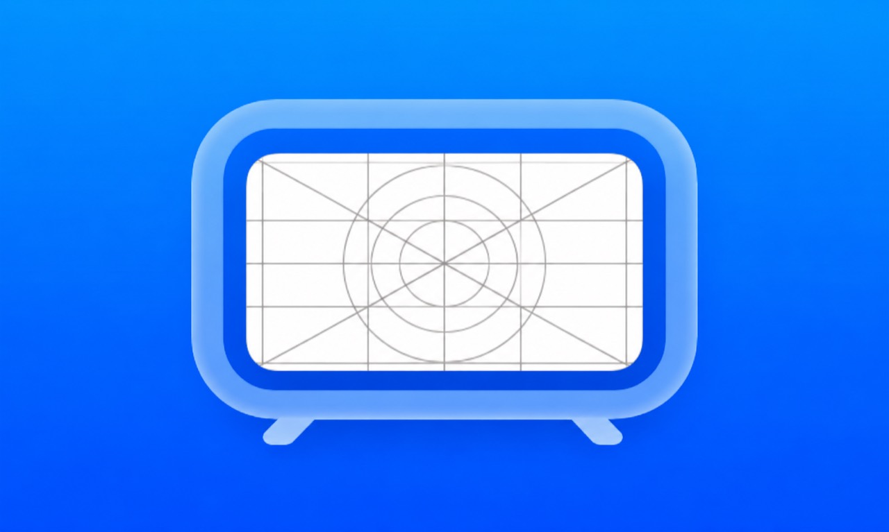

  

# TVContainer

## Your apps without limits

Grab your remote and make room for something new! TVContainer got the same essential features of LiveContainer, but on Apple TV! No 3 app limit🙏🙏

Built on [LiveContainer](https://github.com/LiveContainer/LiveContainer), with an interface designed for the couch and your Siri Remote.

**[Get TVContainer](https://github.com/hubzzzgr/TVContainer/releases/latest)** · **[Set up with SideTVStore](https://github.com/hubzzzgr/SideStore-tvOS)**

## Requirements

- Apple TV running tvOS 17 or later (arm64).
- An Apple TV development provisioning profile for your device.
- A P12 signing identity from the same developer team used to sign TVContainer.
- Decrypted tvOS IPAs for guest apps. iOS, encrypted, and simulator binaries are not supported.

## Download and installation

Download [TVContainer.ipa from the latest release](https://github.com/hubzzzgr/TVContainer/releases/latest).

**Recommended: [SideTVStore](https://github.com/hubzzzgr/SideStore-tvOS)**—my Apple TV sideloading tool. It runs on your iPhone and lets you pair with your Apple TV, sign tvOS IPAs, and install them over local Wi-Fi. Download TVContainer above, then follow [SideTVStore's setup guide](https://github.com/hubzzzgr/SideStore-tvOS#getting-started) to get it onto your TV.

The IPA is unsigned. Sign it with your Apple TV development provisioning profile, preserving `get-task-allow` and the supplied keychain groups, then install it on your Apple TV.

## Usage

1. Open **Settings** and enter a direct P12 certificate download URL and its password. The identity is validated and saved in the device Keychain.
2. Open **Install from URL** and enter a direct download link to a decrypted tvOS IPA. ZIP downloads containing one IPA are also supported.
3. Select an app card, then **Launch**, or press **Play/Pause** in the details screen.
4. Inside a guest app, hold **Play/Pause** for two seconds to request a return to the library.

## Compatibility and storage

TVContainer does not emulate iOS frameworks; iPhone apps must be ported or rebuilt for tvOS. Guest app extensions and arbitrary external tweaks are not supported.

Apps and containers use purgeable local cache storage and may be removed by tvOS when storage is low. Keep original IPAs and external backups of important guest data.

A successful build does not establish on-device compatibility. See the [tvOS build and usage guide](TVContainer/README.md) for runtime limitations and device validation details.

## Building

On a Mac with Xcode and XcodeGen, follow the [build guide](TVContainer/README.md#build). Build the **TVContainer** scheme in the generated **TVContainer.xcodeproj** using [project.yml](project.yml).

GitHub Actions builds only the standalone `TVContainer.ipa`.

## License and credits

[GNU Affero General Public License v3.0](LICENSE).

TVContainer is based on [LiveContainer](https://github.com/LiveContainer/LiveContainer). Thanks to its authors and contributors, and to the shared projects and research used by the runtime:

- [Restoring Dyld Memory Loading](https://blog.xpnsec.com/restoring-dyld-memory-loading) by xpn.
- [CFastFind](https://github.com/pinauten/PatchfinderUtils/blob/master/Sources/CFastFind/CFastFind.c) by LinusHenze ([MIT license](https://github.com/pinauten/PatchfinderUtils/blob/master/LICENSE)).
- [litehook](https://github.com/opa334/litehook) ([MIT license](https://github.com/opa334/litehook/blob/main/LICENSE)).
- [ZSign](https://github.com/zhlynn/zsign) by zhlynn, using the version modified for [Feather](https://github.com/khcrysalis/Feather) and LiveContainer.
